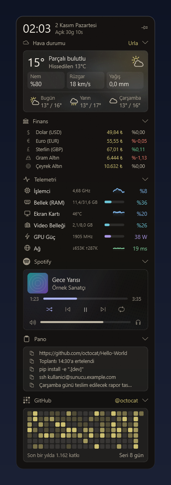

# Pervaz

Ekranın sağ kenarından kayarak açılan, modüler bir Windows durum paneli. Her bilgi
(hava durumu, sistem, piyasa, müzik...) bağımsız bir **kart**tır; kartlar açılıp
kapanabilir, katlanabilir ve sıralanabilir.

<p>
  
</p>

> Proje geliştirme aşamasında (sürüm 0.2.0). Şu an panel iskeleti, tema katmanı, üst bilgi satırı ve
> **hava durumu**, **finans** (döviz, altın), **telemetri**, **Spotify**, **pano** ve **GitHub**
> kartları çalışıyor. Takvim ve pil/ses kartları sırayla eklenecek.

## Özellikler

Hiçbir kart hesap, token ya da API anahtarı istemez.

| Kart | Ne gösterir | Veri kaynağı | Hesap gerekir mi |
| --- | --- | --- | --- |
| [Hava durumu](docs/cards/weather.md) | Sıcaklık, nem, rüzgâr, yağış, üç günlük tahmin | Open-Meteo | Hayır |
| [Finans](docs/cards/finance.md) | Döviz, altın ve gümüş fiyatları, günlük değişim | Truncgil, yedek olarak Altınkaynak | Hayır |
| [Telemetri](docs/cards/telemetry.md) | İşlemci, bellek, ekran kartı ve ağ (ping) canlı grafikleri | Bilgisayarın kendisi (psutil, NVML) | Hayır |
| [Spotify](docs/cards/spotify.md) | Çalan şarkı, kapak, kontrol düğmeleri, ses ve çıkış cihazı | Windows medya oturumu | Hayır |
| [Pano](docs/cards/clipboard.md) | Son 5 kopyalanan metin, tek tıkla geri kopyalama | Panonun kendisi (diske yazılmaz) | Hayır |
| [GitHub](docs/cards/github.md) | Katkı tablosu, yıllık toplam ve seri | Herkese açık profil sayfası | Hayır |

## Hızlı başlangıç

Gereksinimler: **Windows 10/11** ve **Python 3.11** ya da üstü.

```bash
python -m venv .venv
.venv\Scripts\activate
pip install -e ".[dev]"
pervaz                  # ya da: python -m pervaz / python packaging/launcher.py
```

Kurulum yapmak istemezsen hazır `Pervaz.exe`'yi, GitHub'daki ilgili CI çalıştırmasının
([Actions](https://github.com/egemenilerigelen/pervaz/actions)) **Artifacts** bölümünden
(`Pervaz-exe`) indirebilirsin.

## Kullanım

- **Açmak:** sağ kenardaki ince tutamacın üzerine gel (varsayılan 200 ms bekler) ya da
  tıkla. `Win+Alt+P` kısayolu ve tepsi ikonu da paneli açıp kapatır.
- **Kapatmak:** panelin dışına tıkla ya da fareyi panelden 3 sn uzak tut. Kısayol ve tepsi
  ikonu her zaman kapatır.
- **Sabitlemek:** üst satırdaki iğne düğmesi paneli açık tutar; dışarı tıklama ve fare
  ayrılması kapatmaz. Durum hatırlanır.
- **Katlamak:** kart başlığına tıkla; durum hatırlanır.
- **Tepsi:** simgeye tıklamak paneli açıp kapatır; sağ tık menüsünde "Paneli aç / kapat",
  "Açık tut" ve "Çıkış" vardır.

Aynı anda tek kopya çalışır; ikinci kez açılırsa "Uygulama zaten çalışıyor" uyarısı çıkar.

## Ayarlar

Tek dosya: `%APPDATA%\Pervaz\settings.json` (uygulama kapalıyken düzenle; hatalı
değerler sessizce varsayılana döner). Ayarlar ekranı sonraki aşamada gelecek.

Başlıca seçenekler:

- **Açılış ve kapanış:** `open_mode` (`hover` ya da `click`), `hover_delay_ms`,
  `leave_close_seconds`, `pinned`.
- **Kısayol:** `hotkey` (varsayılan `win+alt+p`, boş = yok) ve `hotkey_screen`.
- **Tutamaç:** `trigger_screen`, `handle_thickness`, `handle_length`, `handle_position`.
- **Görünüm:** `theme` (`dark`/`light`), `accent` (`#rrggbb`), `density`, `font_scale`,
  `glass_opacity`, `animations`.
- **Kartlar:** `cards` içinde her kart için `enabled`, `collapsed` ve `config`; liste sırası panel
  sırasıdır. Örnekler: hava için `{"city": "Ankara"}`, finans için
  `{"items": ["usd", "eur", "ceyrek"]}`.

Her alanın türü, aralığı, varsayılanı ve geçersiz değerde ne olduğu [ayarlar
referansında](docs/settings.md), kart ayarları kartların kendi sayfalarındadır.

## Kullanıcı verisi ve gizlilik

`%APPDATA%\Pervaz\` klasöründe tutulur:

- `settings.json`: ayarlar
- `weather.json`: son hava durumu yanıtı (internet yokken eski veriyi göstermek için)
- `finance.json`: son finans fiyatları (aynı amaçla)
- `spotify.json`, `spotify_cover.bin`: en son çalan şarkı ve kapağı (Spotify kapalıyken gösterilir)
- `github.json`: son katkı tablosu (internet yokken eski tabloyu göstermek için)
- `logs\app.log`: loglar (sorun bildirirken bu dosyayı ekleyin)

Gizlilik:

- **Hesap, token ya da anahtar istenmez ve saklanmaz.**
- **Pano geçmişi diske yazılmaz:** yalnızca bellektedir, uygulama kapanınca silinir.
- **Parola işaretli pano içeriği atlanır:** parola yöneticilerinin "geçmişe alma" işaretini
  taşıyan metinler listeye hiç girmez.
- Ağ istekleri yalnızca kartların kaynaklarına gider (ayarındaki konum, finans ve GitHub
  kullanıcı adı) ve telemetri kartı ping ölçmek için `1.1.1.1:443`'e TCP bağlantısı kurar.
  Başka bir yere veri gönderilmez.

## Geliştirme

```bash
python -m pytest -q                                        # testler (Qt testleri ekransız çalışır)
python -m ruff check .                                     # lint
python -m ruff format .                                    # biçimlendirme
python -m PyInstaller --noconfirm packaging/pervaz.spec    # dist\Pervaz.exe
```

Test stratejisi, exe boyut bütçesi, CI, sürümleme ve commit kuralları
[geliştirme rehberinde](docs/development.md).

## Mimari bir bakışta

Bağımlılık yalnızca aşağıya doğru akar; kurallar `tests/test_architecture.py` ile her test
çalışmasında denetlenir.

```text
app  ->  cards/<özellik>  ->  core  ->  infra, theme
```

```text
src/pervaz/
├── identity.py       # uygulamanın kimliği (tek kaynak)
├── app/              # birleştirme noktası: bootstrap (süreç kurulumu) + AppController
├── core/             # panel iskeleti; hiçbir karta bağımlı değil
│   ├── cards/        # kart sözleşmesi, çerçevesi, yaşam döngüsü
│   ├── panel/        # çerçevesiz yüzen pencere, zemin, üst bilgi, otomatik kapanma
│   ├── trigger/      # tetikleyici arayüzü + tutamaç
│   ├── platform/     # Windows'a özgü: kısayol, fare, tek kopya kilidi
│   └── settings.py · polling.py · tray.py · widgets.py ...
├── cards/            # her kart kendi paketi; kartlar birbirini bilmez
│   └── weather/ · finance/ · telemetry/ · spotify/ · clipboard/ · github/
├── theme/            # tüm renk, boyut, yazı tipi: tokens.py (tek yer) + stil sayfası
└── infra/            # kaynaktan bağımsız altyapı: yollar, JSON depolama, http, log
```

Katmanlar, yaşam döngüleri ve veri akışı için [mimari dokümanı](docs/architecture.md); alınan
kararlar için [ADR'ler](docs/decisions).

## Yeni kart eklemek

1. `cards/<ad>/` paketini aç.
2. `Card`'dan türeyen sınıfı yaz (`card.py`); dış bağımlılıkları `Protocol` ile kurucudan al.
3. `__init__.py` içinde `SPEC` (`CardSpec`) dışa aktar.
4. `cards/__init__.py` içindeki `CARDS` demetine ekle.
5. Testini ve `docs/cards/<ad>.md` belgesini yaz; sözleşme testi kartı kendiliğinden kapsar.

Çalışan, test edilmiş bir örnekle adım adım rehber: [Yeni kart eklemek](docs/adding-a-card.md).

## Sorun giderme

- **"Kısayol kaydedilemedi" uyarısı:** kısayolu (ör. `Win+Alt+W`) başka bir uygulama tutuyor
  olabilir. Paneli tutamaçtan ya da tepsi ikonundan aç ve `hotkey` ayarını değiştir
  ([ayarlar](docs/settings.md#kısayol-ve-ekran)).
- **Ekran kartı satırları görünmüyor:** ekran kartı yalnızca NVIDIA'dan (sürücüyle gelen NVML)
  okunur. NVIDIA kartı ya da sürücüsü yoksa üç GPU satırı hiç görünmez.
- **Spotify kartında "Spotify açık değil" yazıyor:** kart yalnızca Spotify masaüstü uygulamasını
  izler (tarayıcı sekmelerini ya da başka çalarları değil). Uygulama açılıp bir şarkı çalınca
  güncel şarkı gelir.
- **"Uygulama zaten çalışıyor" uyarısı:** Pervaz zaten açık; sistem tepsisine bak.
- **Bir kartta "eski veri" ya da hata yazıyor:** kaynağa ulaşılamıyordur; son veri gösterilmeye
  devam eder, bağlantı gelince kendiliğinden düzelir.
- **Loglar:** `%APPDATA%\Pervaz\logs\app.log`. Sorun bildirirken bu dosyayı ekle.
- **Ayarları sıfırlamak:** uygulama kapalıyken `settings.json` dosyasını sil.

## Yol haritası

- Takvim kartı
- Pil ve ses kartları
- Ayarlar ekranı (şimdilik ayarlar `settings.json` ile elle yapılıyor)

## Lisans

MIT.
