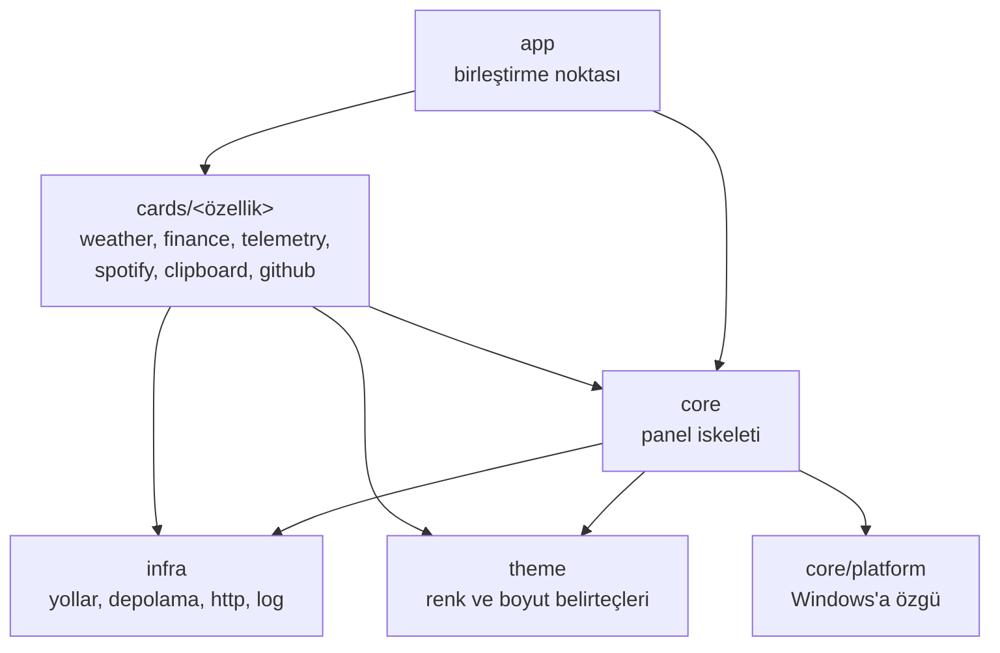
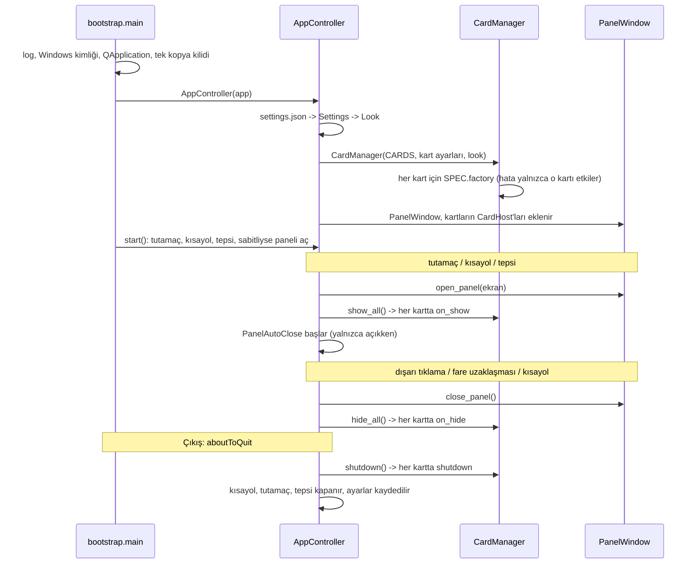

# Mimari

Pervaz, her biri bağımsız bir paket olan **kartlardan** oluşan, ekranın kenarından açılan bir
Windows panelidir. Bu sayfa katmanları, yaşam döngülerini ve veri akışını anlatır.

## Katmanlar

Bağımlılık yalnızca aşağıya doğru akar:

```text
app  ->  cards/<özellik>  ->  core  ->  infra, theme
```



| Katman | Sorumluluğu | Neleri bilebilir |
| --- | --- | --- |
| `identity` | Uygulamanın adı, Windows kimliği, veri klasörü değişkeni | hiçbir şey; herkes okuyabilir |
| `infra` | Dosya yolları, atomik JSON yazma, `JsonCache`, HTTP, log | `identity` |
| `theme` | Tüm renk, boyut ve yazı tipi belirteçleri, stil sayfası | `identity` |
| `core` | Panel penceresi, kart altyapısı, ayarlar, tetikleyici, yoklama | `infra`, `theme`, `core/platform` |
| `core/platform` | Kısayol, fare, tek kopya kilidi, görev çubuğu kimliği, açık kalma süresi | yalnızca kendisi ve `identity` |
| `cards/<özellik>` | Tek bir bilgi kartı | `core`, `infra`, `theme`; başka bir kartı **bilmez** |
| `cards` (kök) | Kart kayıt defteri `CARDS` | tüm kart paketleri |
| `app` | Hepsini birbirine bağlar | her şeyi; kimse `app`'i import etmez |

Kurallar `tests/test_architecture.py` ile her test çalışmasında denetlenir: katman yönleri,
döngüsel import olmaması ve her kart paketinin `SPEC` dışa aktarıp `CARDS`'ta kayıtlı olması.
Bu test asla gevşetilmez; bağımlılık yanlış katmandaysa kod taşınır.

### Klasör yapısı

```text
src/pervaz/
├── identity.py        # kimliğin tek kaynağı
├── app/               # bootstrap.py (süreç kurulumu) · controller.py (AppController)
├── core/
│   ├── cards/         # base.py (Card, CardSpec, CardContext, guarded) · host.py · manager.py
│   ├── panel/         # window.py · blackhole.py · pin_motion.py · surface.py · header.py · auto_close.py · screens.py
│   ├── trigger/       # Trigger arayüzü ve tutamaç
│   ├── platform/      # hotkey · mouse · single_instance · appid · uptime
│   ├── settings.py · polling.py · tray.py · widgets.py · turkish.py
├── cards/<kart>/      # her kart kendi paketi (bkz. docs/adding-a-card.md)
├── theme/             # tokens.py (tüm renk/ölçü) · stylesheet.py
└── infra/             # paths · storage · http · logging_setup
```

## Uygulama yaşam döngüsü



`AppController` karar vermez, bağlar: tutamaç, kısayol ve tepsi aynı `open_panel`/`toggle_panel`
metotlarına gider. Panel kara delik efektiyle tutamaçtan çıkıp oraya girdiği için tutamaç
animasyon boyunca görünür kalır: panel yerine oturunca gizlenir, kapanış başlarken geri gelir.

## Kart yaşam döngüsü

Bir kart `core/cards/base.py` içindeki `Card` sözleşmesine uyar:

| Çağrı | Ne zaman | Kartın yapması gereken |
| --- | --- | --- |
| `SPEC.factory(CardContext)` | Uygulama açılırken | Kartı kur; ayarı `context.config`'ten oku. Hata fırlatırsa yalnızca o kart başlatılamaz |
| `on_show()` | Panel açıldı | Zamanlayıcıları ve yoklamayı başlat, bayat veriyi tazele |
| `on_hide()` | Panel kapandı | Zamanlayıcıları ve animasyonları durdur |
| `on_collapsed(bool)` | Kart katlandı/açıldı (kurulurken katlıysa bir kez de) | Gövde görünmezken gereksiz işi durdur; katlıyken başlıkta özet gösterebilir |
| `set_look(look)` | Tema değişti | Renklere bağlı çizimleri yenile |
| `shutdown()` | Uygulama kapanıyor | Arka plan işlerini durdur, kaynakları bırak |

Kartın dışarıya açtığı sinyaller: `info_changed` (başlık satırındaki kısa bilgi),
`error_changed` (kartın içinde gösterilen hata; boş metin = hata yok) ve `config_changed`
(ayar değişti, kalıcı saklanmalı). Kart bunları `set_info`, `fail`/`clear_error` ve
`save_config` ile yayınlar.

### Hata izolasyonu

Bir kartın hatası paneli ve diğer kartları çökertmez:

- Fabrika hata verirse `CardManager` yalnızca o kartın çerçevesinde `Bu kart başlatılamadı`
  gösterir, diğer kartlar kurulur.
- `CardHost`, `on_show`/`on_hide`/`shutdown` gibi yaşam döngüsü çağrılarını yakalar.
- Kartın sinyal yuvaları ve zamanlayıcı geri çağrıları `@guarded` ile sarılır: beklenmedik bir
  istisna loga yazılır ve kartın içinde `Bu kart beklenmedik bir hata verdi` görünür.
- Beklenen hatalar (ağ yok, kaynak bozuk) için kart kendi anlaşılır mesajıyla `fail()` çağırır.

## Veri akışı

Ağ ya da sistem okuyan kartlar aynı kalıbı izler:

```text
kaynak (Protocol) -> arka plan iş parçacığı -> model (donmuş dataclass) -> önbellek -> kart -> widget
```

- **Kaynak** kartın dış dünyasıdır (HTTP, Windows API, psutil). Bir `typing.Protocol` ile
  tanımlanır ve kurucudan verilir; testler sahte bir kaynak verir.
- **Arka plan iş parçacığı** `core/polling.py` içindeki `Poller` ile açılır. `Poller` her istekte
  ayrı bir daemon iş parçacığı kullanır, sonucu kuyruklu sinyalle ana iş parçacığına taşır ve
  her isteğe bir "nesil" numarası verir: `stop()` ya da kaynak değişimi sonrası geç gelen sonuç
  yok sayılır. İş parçacığı daemon olduğu için bloklanan bir HTTP isteği kapanışı geciktirmez.
  Hata sonrası yeniden deneme 10, 20, 40... saniye (yenileme aralığını aşmadan).
  Spotify, COM/WinRT iş parçacığına bağlı olduğundan kendi tek `Worker` iş parçacığını kullanır.
- **Model** değişmezdir (`@dataclass(frozen=True)`), `to_dict`/`from_dict` ile serileştirilir.
- **Önbellek** `infra/storage.py` içindeki `JsonCache[T]`'den türer: `encode`/`decode` verilir,
  bozuk dosya uyarı + `None`, yazılamayan dosya yalnızca uyarıdır. Yazma atomiktir
  (geçici dosya + yer değiştirme), yarım dosya kalmaz.
- **Kart** yalnızca model üzerinden çizer ve her sinyal yuvası `@guarded`'dır.

## Ayar akışı

```text
settings.json -> SettingsStore.load -> Settings (doğrulanmış) -> look_from_settings -> Look -> stil sayfası
```

- `Settings.from_dict` her alanı doğrular; bozuk değer varsayılana döner (bkz.
  [ayarlar](settings.md)).
- `Look` = tema renkleri (`theme.tokens`) + boyutlar (`Metrics`: yoğunluk, yazı ölçeği). Stil
  sayfası (`theme/stylesheet.py`) `Look`'tan üretilir; widget'lar yalnızca `role` özelliğini
  bilir (`label.setProperty("role", "dim")`).
- Kullanıcı bir şeyi değiştirince (sabitleme, katlanma, kart ayarı) `AppController` ayarı
  `settings.json`'a yazar; çıkışta da bir kez yazılır.

## Görünüm kuralları

- Kartlarda sabit renk ya da ölçü yoktur; hepsi `theme/tokens.py`'den gelir. Açık ve koyu tema
  ikisi de desteklenir ve metin her zeminde okunur kalır (kontrast testleri vardır).
- Arayüz **zıplamaz**: kart katlanırken, kaydırma çubuğu belirirken ya da metin değişirken
  yerleşim kaymaz. Kaydırma çubuğunun yeri hep ayrılır; katlanan kartın başlığı ile gövdesi
  arasındaki boşluk gövdenin içindedir.
- Başlık bilgisi varsayılan olarak boştur; yalnızca anlamlı olduğunda (eski veri, yedek kaynak,
  katlıyken özet) görünür.

## Performans

- Panel kapalıyken kartların zamanlayıcıları durur (`on_hide`); fare izleme zamanlayıcısı
  (100 ms) yalnızca panel açıkken çalışır; üst bilgi saati dakika başında bir kez tetiklenir ve
  yalnızca açıkken. Boşta işlemci kullanımı yaklaşık %0'dır.
- Bilerek panel kapalıyken de çalışanlar: hava ve GitHub kartı (hafif istek, 20/30 dakikada bir,
  panel açılınca veri hazır olsun diye) ve pano kartı (olay tabanlı, yoklama yok).
- Ağır iş (ağ, sistem okuma, Windows API) ana iş parçacığında yapılmaz.
- Panel, kart ve arka plan çizimleri bir kez çizilip önbelleğe alınır.
- Kara delik efekti yalnızca animasyon boyunca çalışır: panelin bir görüntüsü alınır, ağ üzerinde
  bükülür (kare başına ~10 ms) ve bitince görüntü bırakılır. OpenGL ya da yeni bir Qt modülü
  gerektirmez. Raptiye efekti de aynı yolla, panel görüntüsünü raptiye çevresinde döndürür.
- Exe boyutu ~28 MB hedeflenir; neden ve nasıl için bkz. [geliştirme](development.md#exe-ve-boyut-bütçesi).
